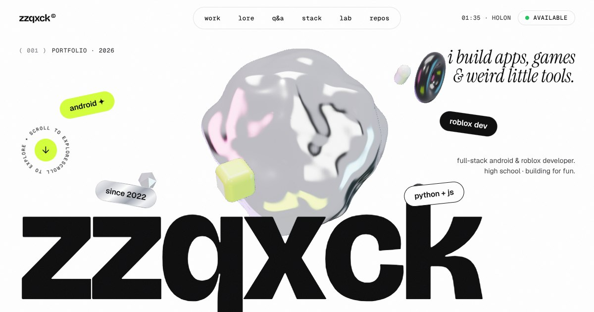

# zzqxck · portfolio

### 🌐 **[Visit the site → zqh7y.github.io/Portfolio](https://zqh7y.github.io/Portfolio/)**

Works on phone and desktop, no install needed.



I build apps, web, games and programs, mostly with React Native + Expo.
Highlights: **Metz** (a meetups app, my biggest project), **5 apps shipped to Google Play** (Virtual Live passed 10K downloads), and games like **Dice Idle** and **Driftwood Dock**.

Find me: [Instagram](https://www.instagram.com/zzqxck/) · [TikTok](https://www.tiktok.com/@zzqxck) · [GitHub](https://github.com/zqh7y)

---

## How it's built
- **Python (Flask)** renders the page from `data/profile.json` and serves a small JSON API.
- **JavaScript** (no build step) does everything that moves: GSAP + ScrollTrigger scroll animations, Lenis smooth scroll, and two **Three.js** scenes: a holographic chrome blob in the hero and an egg-hatching lab.

## Run it

```bash
pip install -r requirements.txt
python app.py
# → http://localhost:5000
```

The JS libraries are already vendored in `static/vendor/`, so npm is optional. To update them:

```bash
npm install
npm run vendor
```

## Tests

```bash
pip install -r requirements-dev.txt
python -m pytest
```

## What's where

| Path | What it does |
| --- | --- |
| `app.py` | Flask app: `/` page, `/api/repos.json`, `/api/stats.json`, `/api/odds.json`, `/api/profile.json`, `POST /api/hatch` |
| `build.py` | Static export to `dist/` for GitHub Pages |
| `backend/github.py` | Live repo feed from the GitHub API (cached 15 min). Falls back to `data/repos_snapshot.json` when offline |
| `backend/derive.py` | Everything that updates itself: years, language counts, games count, the "now" date, newest project, new-repo cards |
| `scripts/sync.py` | The daily sync: finds new repos, writes their cards (text + pictures from the README), refreshes the snapshot |
| `data/auto_projects.json` | Cards the sync wrote for new repos. Don't edit by hand, it's rewritten every day |
| `backend/hatch.py` | Server-side egg rolls: the server rolls first, the browser just animates the result |
| `data/profile.json` | **All the text on the site**: bio, projects, timeline, Q&A, stack. Edit this to change content |
| `templates/index.html` | Page markup (Jinja) |
| `static/js/main.js` | Boot, loader, smooth scroll, scroll animations, lab UI |
| `static/js/hero-scene.js` | Three.js hero blob (custom noise shader + holographic studio lighting) |
| `static/js/egg-lab.js` | Three.js egg + cube pets + confetti |
| `static/js/tag-sphere.js` | Draggable 3D tag sphere |
| `static/js/fx.js` | Cursor, magnetic buttons, tilt, text scramble, stickers, marquees |
| `static/js/repos.js` | "The archive": every public repo with language filters |

## It updates itself

Once a day (and on every push) GitHub Actions runs `scripts/sync.py`, commits what changed and redeploys. So you don't have to touch the site when you make something new:

- **New repo → new project card.** Any public repo created after `auto_since` that `profile.json` doesn't mention yet gets a card at the front of "games & programs", with a **new** badge. The title and text come from its README, the pictures from the README's images (phone screenshots get the 3-phone look), and the stack from its languages. No pictures? It gets a colourful code-window card instead.
- **Write it up when you feel like it.** Add the project to `featured` in `profile.json` (or the repo name to `hidden_repos` / `auto_skip`) and the auto card goes away by itself.
- **Numbers and dates that would go stale:** "shipping since 2022" years (`"auto": "years"` on a fact), the games count (`"count_from": "featured:game"` on a pillar), language repo counts (the real count from GitHub or your number, whichever is higher), the timeline entry with `"date": "now"` (shows the current month), the "newest thing you made?" card (`"auto": "newest"`), the "last push" line in *currently* and the "updated" date in the footer.

Run it yourself: `python scripts/sync.py`, or `python scripts/sync.py --preview SomeRepo` to see the card it would make. Tip: GitHub pauses daily workflows in repos with no activity for 60 days; if that happens, press **Run workflow** under Actions once.

## Editing content

Everything personal lives in `data/profile.json`:

- `qa`: the "rapid fire" flip cards. Add `{"q": "...", "a": "..."}` entries.
- `featured`: the big project cards (image paths are relative to `static/`). `screens` takes up to 3 phone screenshots.
- `lore`: the timeline.
- `hidden_repos` / `description_overrides`: control what the GitHub archive shows.
- `email`: leave empty to hide it, or set it to show a copy-to-clipboard button.

Set `GITHUB_TOKEN` in the environment if you hit GitHub's anonymous rate limit.

## Static version (GitHub Pages)

`build.py` exports the whole site as plain files, so it can live on any static host:

```bash
SITE_URL=https://zqh7y.github.io/Portfolio/ python build.py   # -> dist/
```

Data is captured at build time into `dist/api/*.json`, and the egg lab rolls in the browser
(same odds as the Python server). To publish on GitHub Pages, push the contents of `dist/`
to a `gh-pages` branch and pick that branch under **Settings → Pages**.

## Deploy

The live site is deployed by GitHub Actions (`.github/workflows/pages.yml`): every push to `master`, and once a day on its own, runs the sync, then `build.py`, and publishes `dist/` to GitHub Pages.

To run the full Python version instead, any host that runs Python works (Render, Railway, Fly, a VPS). A `Procfile` is included:

```
web: gunicorn app:app --bind 0.0.0.0:$PORT
```
